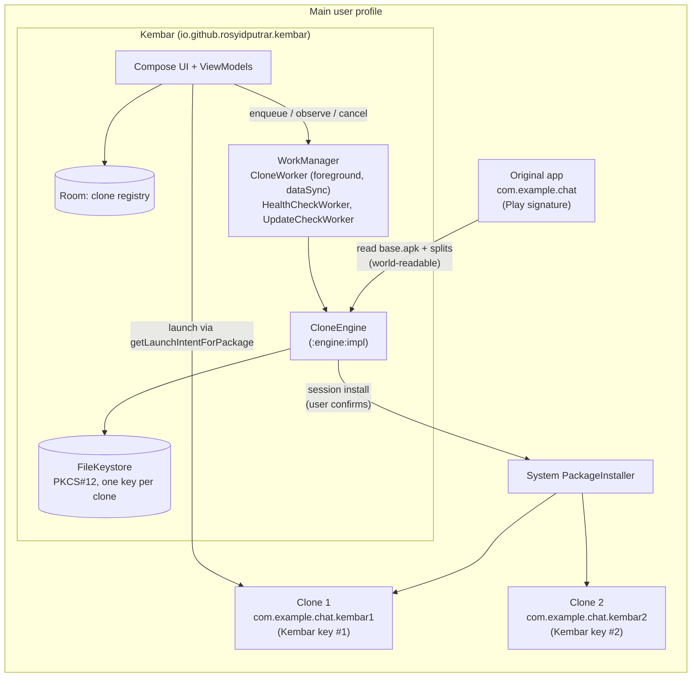
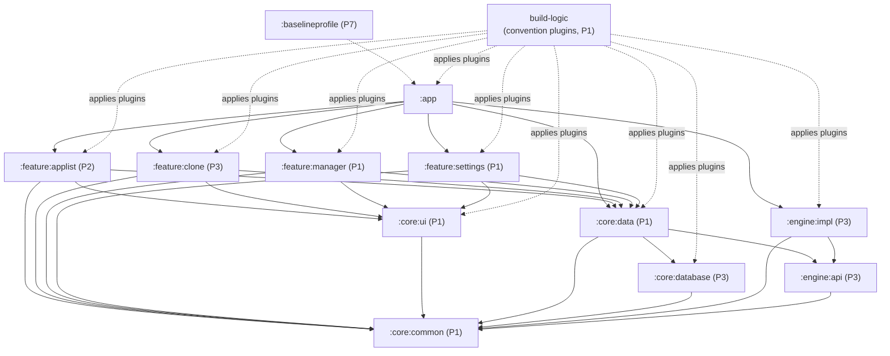
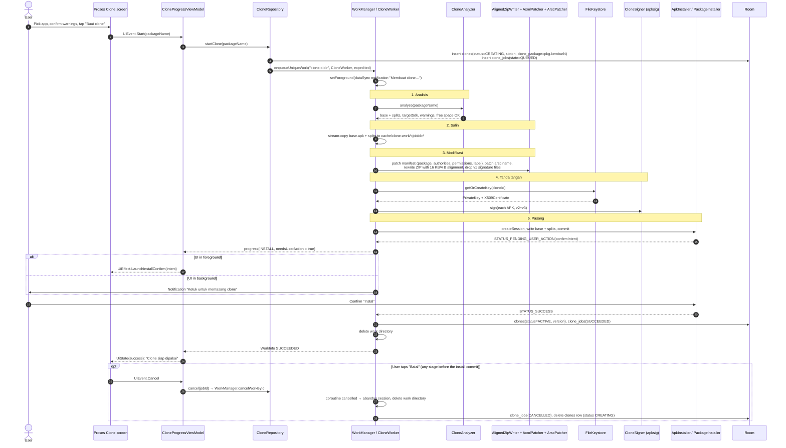
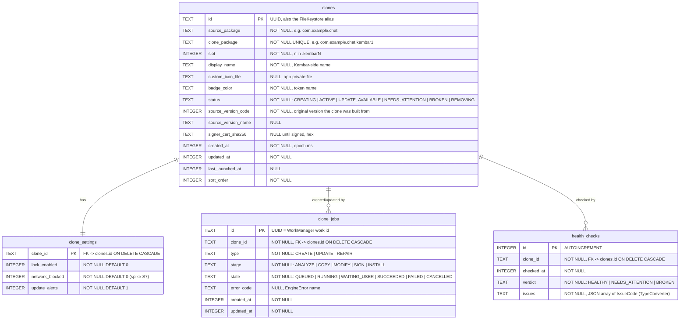

# Kembar: architecture

Engine: **B, repackaging** ([ADR-0001](adr/0001-clone-engine.md)).

## 1. Runtime picture

Every clone is an ordinary app with its own UID, data directory, notification channels,
WebView data and FCM identity (which may not work, see ADR-0001 L2).

## 2. Module graph

Modules are created in the phase that first needs them, so no module is ever empty.

Rules:

- Feature modules never depend on each other or on `:engine:impl`. Navigation is wired in `:app`.
- `:core:data` exposes repository **interfaces and domain models**. Implementations are
  `internal` and bound with Hilt. Use cases live in the feature module that owns them.
- Onboarding, disclaimer and splash live in `:app`, because they decide the start
  destination and belong to no single feature.
- `:engine:api` is the contract (`CloneEngine`, `CloneRequest`, `CloneProgress`, `EngineError`).
- `:engine:impl` holds the pipeline. Its binary-format code (`StringPool`, `AxmlPatcher`,
  `ArscPatcher`, `AlignedZipWriter`) uses no Android APIs, so it is unit-tested on the
  host JVM against fixtures built with `aapt2`/`d8` and verified with
  `apksigner`/`zipalign` from build-tools 34.0.0.
- `:core:testing` holds test-only helpers (fake repositories, the JUnit 5 main-dispatcher
  extension). Only `testImplementation` depends on it, so it never ships in the APK.
- No NDK module.

## 3. Engine internals (`:engine:impl`)

| Class | Responsibility |
|-------|----------------|
| `CloneAnalyzer` | Reads `PackageInfo`, base + split paths, `targetSdkVersion`, `sharedUserId`, native-lib layout, Google-services markers. Checks free space. Applies the bundled compatibility list. Returns `Compatibility` with Indonesian-mappable reason codes. |
| `StringPool` | Parses and serializes `ResStringPool` chunks (UTF-8 and UTF-16, styles preserved). Appends strings. |
| `AxmlPatcher` | Parses binary XML chunks (string pool, resource map, namespaces, elements, CDATA). Applies `ManifestRewriteRules` (section 4.1 of ADR-0001), matching attributes by **resource ID** (e.g. `android:name` = `0x01010003`) rather than by name. Re-serializes the result. |
| `ArscPatcher` | Renames the `ResTable_package.name` field (`char16[128]`) of the app's package in `resources.arsc` (base and config splits). Leaves everything else alone. |
| `AlignedZipWriter` | Streams entries from the source APK into a new ZIP. Swaps in the patched manifest/arsc and drops `META-INF` v1 signature files. Keeps STORED entries STORED: `resources.arsc` 4-byte aligned (required for targetSdk ≥ 30), `.so` 16 KB aligned, others 4-byte aligned. Never loads a whole APK into memory. |
| `FileKeystore` | PKCS#12 file in `noBackupFilesDir`. Random password, encrypted by an Android Keystore AES-256-GCM key. One EC P-256 key + self-signed certificate per clone (alias = clone id). Passphrase-encrypted export/import. |
| `CloneSigner` | apksig 8.5.2 `ApkSigner`: v2 + v3, v1 off, `minSdkVersion` 29, `setAlignmentPreserved(true)`. |
| `ApkInstaller` | `PackageInstaller` session (`MODE_FULL_INSTALL`, `setPackageSource(PACKAGE_SOURCE_LOCAL_FILE)` on API 33+, `setRequireUserAction(USER_ACTION_NOT_REQUIRED)` for updates on API 31+). Writes base + splits in one session, commits with a mutable `PendingIntent`, and surfaces `STATUS_PENDING_USER_ACTION` to the UI or a notification. |
| `CloneEngine` (impl) | Orchestrates the stages, emits `CloneProgress`, and cleans up the work directory on success, failure or cancellation. |

## 4. Clone pipeline

Stages shown in the UI: **Analisis → Salin → Modifikasi → Tanda tangan → Pasang**.

Process death and configuration changes: the job is a unique WorkManager work item and
the UI only observes `WorkInfo`, so rotating the screen or killing the process doesn't
lose it. If the worker is killed mid-pipeline, WorkManager retries it. The retry starts
again from **Analisis** with a clean work directory, because the stages are idempotent.
A pending install session found at retry is abandoned first.

## 5. Data model (Room, `:core:database`, Phase 3)

Schema export to `core/database/schemas`. Every version bump ships an explicit `Migration`
and a `MigrationTestHelper` test.

Constraints and indexes:

- `clones`: `UNIQUE(clone_package)`, `UNIQUE(source_package, slot)`, index on `status`.
- `clone_jobs`: index on `clone_id`, `state`.
- `health_checks`: index on `(clone_id, checked_at)`. Keep only the last 10 per clone.

DataStore (`:core:data`): `onboarding_completed`, `disclaimer_accepted_version`,
`theme_mode`, `dynamic_color` (Phase 1). Added later: app lock config (PIN as a PBKDF2 hash
with salt, the record encrypted with a Keystore key), `last_package_sequence` for
`PackageManager.getChangedPackages()`, and `key_backup_reminder_dismissed_at`.

Kembar ships **no analytics SDK**. Crash reports are opt-in and local (share sheet).

The Room DB holds metadata only, so file-based encryption is enough at rest. The secrets
(clone signing keys) are in `FileKeystore`, which is Keystore-wrapped. Exported backups
(settings + keys) are passphrase-encrypted so they can be restored on another device.

## 6. Feature feasibility

| # | Feature | v1 status | Notes |
|---|---------|-----------|-------|
| 1 | App picker + incompatibility hints | ✅ | `<queries>` launcher intent, no `QUERY_ALL_PACKAGES`. Hints: system app, targetSdk < 23, `sharedUserId`, Google services markers, known list. |
| 2 | Staged creation + cancel | ✅ | Matches brief stages. Cancel works until the user confirms the system install dialog. |
| 3 | Launch, rename, icon/badge, pin shortcut, clear data, uninstall, backup | ⚠️ | Rename/icon change Kembar's list + shortcuts. The system label is fixed at creation ("… · Kembar n"). Clear data → App Info (L9). Uninstall → system confirm. Backup = settings + keys (L8). |
| 4 | Multiple clones per app | ✅ | `.kembar1`, `.kembar2`, … each with its own key. |
| 5 | Notifications, network, storage, permissions | ⚠️ | Notifications → system settings for the clone package. Storage via `StorageStatsManager` (needs usage access, optional). Permissions via `PackageInfo.requestedPermissionsFlags` (Kembar can see packages it installed). Network depends on S7. |
| 6 | Health check + repair | ✅ | Checks: clone installed, signer matches the stored key, original still installed, launch intent resolvable, key present in `FileKeystore`. Repair = rebuild + reinstall as an update. |
| 7 | Update awareness | ✅ | `getChangedPackages(sequence)` in a periodic worker → original `versionCode` > clone's `source_version_code` → notification + "Perbarui clone" (rebuild as update, data kept). |
| 8 | App lock | ⚠️ | Guards launches through Kembar and its shortcuts only. A clone opened from the launcher can't be intercepted (stated in UI). |
| 9 | Onboarding, help, explainer, disclaimer | ✅ | |

## 7. Permissions (full rationale table in Phase 6)

| Permission | Why | If denied |
|---|---|---|
| `<queries>` MAIN/LAUNCHER | List launchable apps (Android 11+ package visibility) | n/a |
| `REQUEST_INSTALL_PACKAGES` + user's "Instal aplikasi tidak dikenal" toggle | Install clones | Cloning is impossible; Kembar explains and opens the toggle (`ACTION_MANAGE_UNKNOWN_APP_SOURCES`) |
| `REQUEST_DELETE_PACKAGES` | Uninstall clones from inside Kembar | Falls back to `ACTION_DELETE` |
| `FOREGROUND_SERVICE` + `FOREGROUND_SERVICE_DATA_SYNC` | Keep a long clone job alive with a visible notification (local file processing) | n/a (normal permissions) |
| `POST_NOTIFICATIONS` (13+) | Progress, install prompts in background, update alerts | Job continues. Install prompt waits until the user reopens Kembar |
| `USE_BIOMETRIC` | Optional app lock | PIN only |
| `PACKAGE_USAGE_STATS` (optional special access) | App sizes / storage usage | Sizes hidden |
| **Not used:** `QUERY_ALL_PACKAGES`, `INTERNET` (until S7 needs it), any location/contacts/storage permissions | | |
