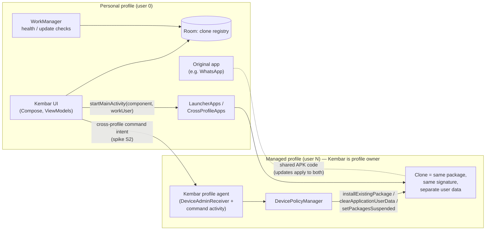
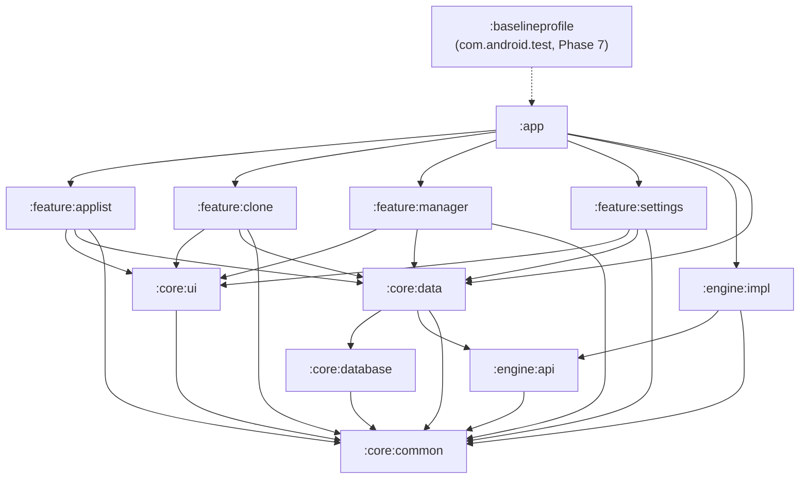
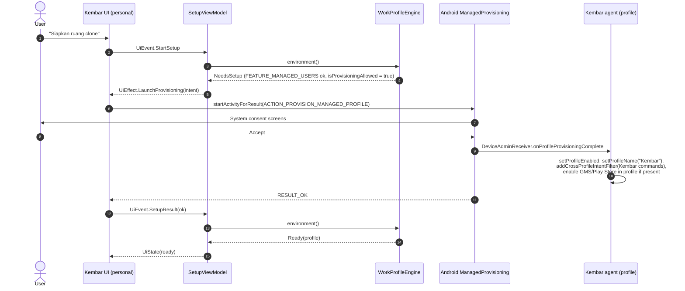
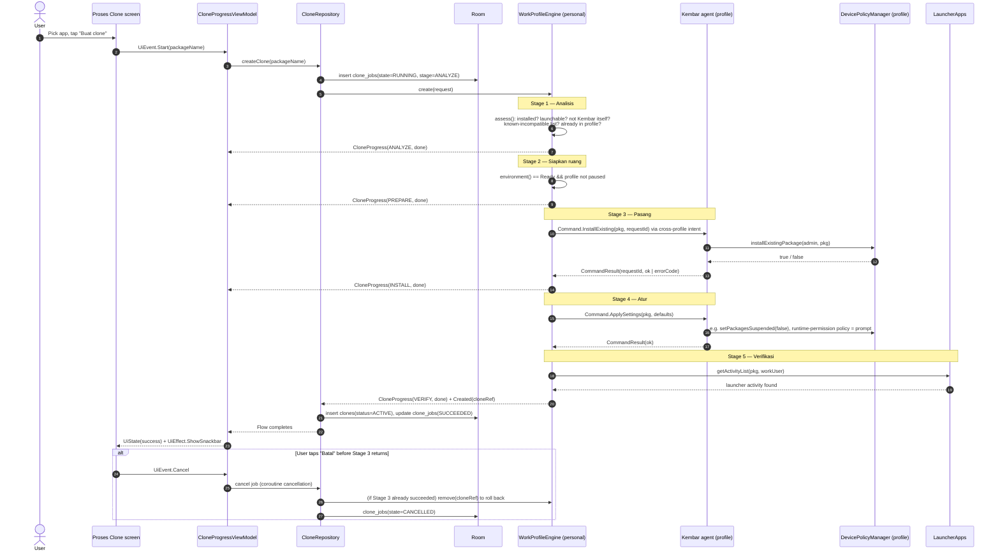
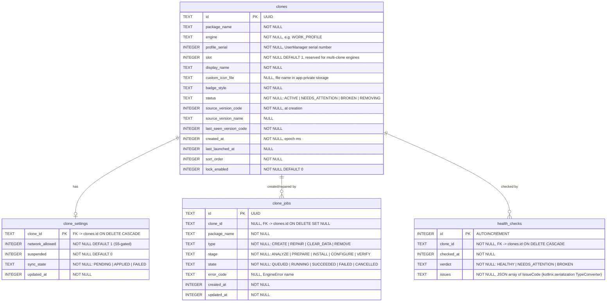

# Kembar: architecture

Status: proposed, depends on [ADR-0001](adr/0001-clone-engine.md) being accepted.

## 1. Runtime topology

The same Kembar APK runs as two instances, each in a different Android user:



Key points:

- The **personal-side instance** owns the UI, the clone registry (Room) and scheduling.
  It can list and launch apps in the profile through `LauncherApps` (API 21) and
  `CrossProfileApps` (API 28) without special permissions.
- The **profile-side instance** ("agent") is the profile owner. Only it can call
  `DevicePolicyManager` methods that act on the profile. It has no UI except a translucent
  command activity, and stores no user data beyond what it needs to apply settings.
- The two instances can't share files or databases (different users). They talk through
  explicit, Kembar-only cross-profile intents. These are protected by a signature-level
  custom permission and by checking the calling package, and carry only small,
  versioned, `@Serializable` command payloads.

## 2. Module graph



Rules:

- Feature modules never depend on each other or on `:engine:impl`. Navigation is wired in `:app`.
- `:core:data` exposes repository **interfaces and domain models**. Implementations are
  `internal` and bound with Hilt. There is no separate `:core:domain` module: use cases
  live in the feature module that owns them, which keeps the graph to the modules the brief lists.
- `:engine:api` has no Android-framework types in its public surface except `UserHandle`
  wrappers. That makes it testable with plain JUnit.
- `:engine:impl` holds the managed-profile engine, the `DeviceAdminReceiver`, the profile
  agent and the command protocol. Only `:app` sees it, to bind `CloneEngine`.
- No NDK module. Nothing in the managed-profile engine needs native code (see ADR-0001).

## 3. Engine API (shape, finalized in Phase 3)

```kotlin
interface CloneEngine {
    val id: EngineId                                        // WORK_PROFILE
    fun environment(): Flow<EngineEnvironment>             // Unsupported(reason) / NeedsSetup / Ready(profile) / Paused
    suspend fun assess(packageName: String): Compatibility // Compatible / LikelyIncompatible(reasons) / Blocked(reason)
    fun create(request: CloneRequest): Flow<CloneProgress> // stage events, cancellable via coroutine cancellation
    suspend fun launch(clone: CloneRef): EngineResult<Unit>
    suspend fun clearData(clone: CloneRef): EngineResult<Unit>
    suspend fun remove(clone: CloneRef): EngineResult<Unit>
    suspend fun health(clone: CloneRef): HealthReport
}
```

`EngineResult` is a sealed type with typed `EngineError` codes (no exceptions across the
boundary). The UI maps each code to an Indonesian message that says **what happened** and
**what to do next**.

## 4. Clone pipeline

Stages (shown in the UI): **Analisis → Siapkan ruang → Pasang → Atur → Verifikasi**.

### 4.1 One-time setup (profile provisioning)



### 4.2 Creating a clone



Why this is not a WorkManager job: a cross-profile command needs Kembar's UI in the
foreground (background activity starts are blocked since Android 10), and the whole
pipeline takes about 1–3 seconds. The job runs in a `viewModelScope`-launched coroutine
backed by the `clone_jobs` row. After process death the row is found in `RUNNING` state
and **reconciled** on next start: Kembar checks `LauncherApps` for the package in the
profile and marks the job `SUCCEEDED` or `FAILED`. WorkManager is used for periodic health
and update checks, which need no UI.

## 5. Data model (Room, `:core:database`)

Schema export is enabled (`room.schemaLocation = $projectDir/schemas`). Every version bump
ships an explicit `Migration` plus a `MigrationTestHelper` test.



Indexes and constraints:

- `clones`: `UNIQUE(package_name, profile_serial, slot)`; index on `status`.
- `clone_jobs`: index on `(state)` and `(clone_id)`.
- `health_checks`: index on `(clone_id, checked_at DESC)`. Keep only the last 10 per clone (pruned by the worker).

Not in Room (DataStore, `:core:data`):

- `onboarding_completed`, `disclaimer_accepted_version`, `theme_mode`, `dynamic_color`.
- App lock: `lock_mode` (NONE / BIOMETRIC / PIN / BIOMETRIC_OR_PIN). The PIN is stored
  only as a PBKDF2-HMAC-SHA256 hash with a random salt, and that record is AES-GCM
  encrypted with a non-exportable Android Keystore key. The relock timeout is stored too.
- `last_package_sequence` for `PackageManager.getChangedPackages()` (update awareness).
- There is no analytics SDK at all, so there is no consent flag. Crash reports are opt-in and
  local (share sheet) in v1.

Why the Room DB isn't SQLCipher-encrypted: it holds only clone metadata (package names,
labels, timestamps), never clone app data. File-based encryption already protects it at
rest. Adding SQLCipher would bring a native library for little gain. The **settings backup
export** is encrypted (AES-256-GCM with a key derived from the user's passphrase), so it
can be restored on another device. A Keystore key can't leave the device, so it isn't used for exports.

## 6. Product feature feasibility under the managed-profile engine

| # | Feature (brief) | v1 status | Notes |
|---|-----------------|-----------|-------|
| 1 | App picker with search/filter/sort, icon/version/size, incompatibility hints | ✅ | `<queries>` for launcher intents, no `QUERY_ALL_PACKAGES`. Size via `StorageStatsManager` only if usage access is granted; otherwise hidden. |
| 2 | Clone creation with stages + cancel | ✅ | Stages renamed (ADR-0001 L14). Cancel is possible until Stage 3 commits; later cancel = rollback. |
| 3 | Launch, rename, icon/badge, pin shortcut, clear data, uninstall, backup | ⚠️ | Rename/icon are Kembar-side only (L5). Backup = Kembar settings only (L4). Uninstall depends on S7. |
| 4 | Multiple clones per app | ❌ | L1. Schema is ready for a future engine. |
| 5 | Notifications, network, storage usage, permission overview | ⚠️ | Notifications → system settings deep link (L7). Network depends on S5 (L8). Storage depends on S6. Permission overview uses `DevicePolicyManager.getPermissionGrantState` in the profile. |
| 6 | Health check + repair | ✅ | Checks: profile exists and is not paused, Kembar is still profile owner, package installed for the profile user, launcher activity present, not suspended unexpectedly. Repair = re-run `installExistingPackage` or re-apply settings. |
| 7 | Update awareness | ✅ (adjusted) | `PackageManager.getChangedPackages(sequence)` in a periodic worker plus a `LauncherApps.Callback` while running. The clone is updated automatically together with the original (L10). |
| 8 | App lock | ⚠️ | Kembar biometric/PIN lock for Kembar UI and shortcuts. Android work-profile lock offered as the strong option (L6). |
| 9 | Onboarding, help, incompatible-apps explainer, disclaimer | ✅ | Also explains that WhatsApp and Instagram have built-in multi-account support. |

## 7. Permissions (preview; full rationale table in Phase 6)

| Permission / declaration | Why | If denied / unavailable |
|---|---|---|
| `<queries>` with `MAIN`/`LAUNCHER` intent | List launchable apps on Android 11+ package visibility | n/a (declaration, not a grant) |
| `BIND_DEVICE_ADMIN` (on the receiver, not requested) | Required for the `DeviceAdminReceiver` that becomes profile owner | n/a |
| `POST_NOTIFICATIONS` (Android 13+) | Update / health alerts | Alerts appear only inside the app (Beranda banner) |
| `USE_BIOMETRIC` | Optional app lock | PIN-only lock |
| `PACKAGE_USAGE_STATS` (special access, optional) | App sizes in picker / storage usage | Sizes hidden; link to system settings |
| **Not used:** `QUERY_ALL_PACKAGES`, `REQUEST_INSTALL_PACKAGES`, `FOREGROUND_SERVICE*`, `INTERNET` (until S5 shows the in-profile VPN needs it) | — | — |
